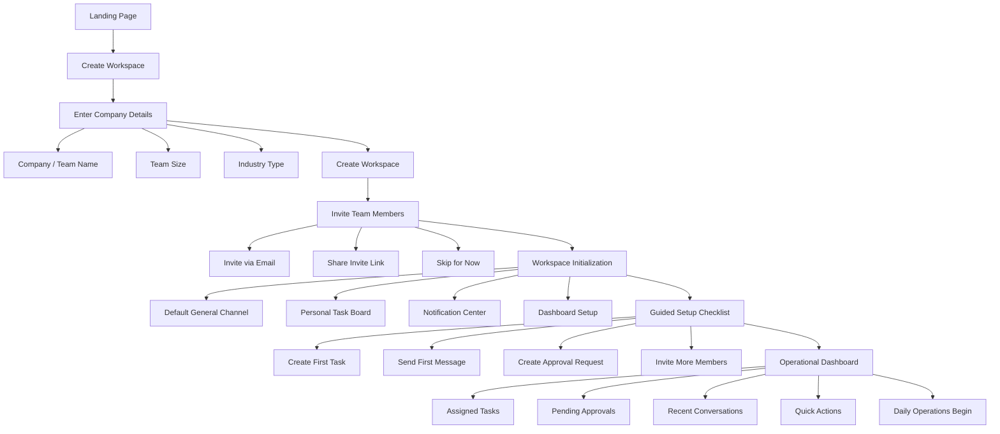
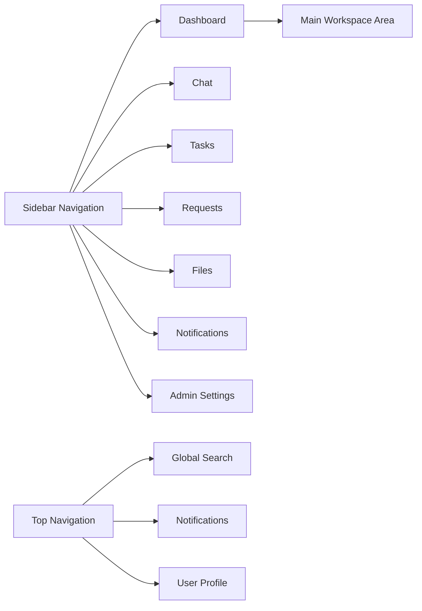
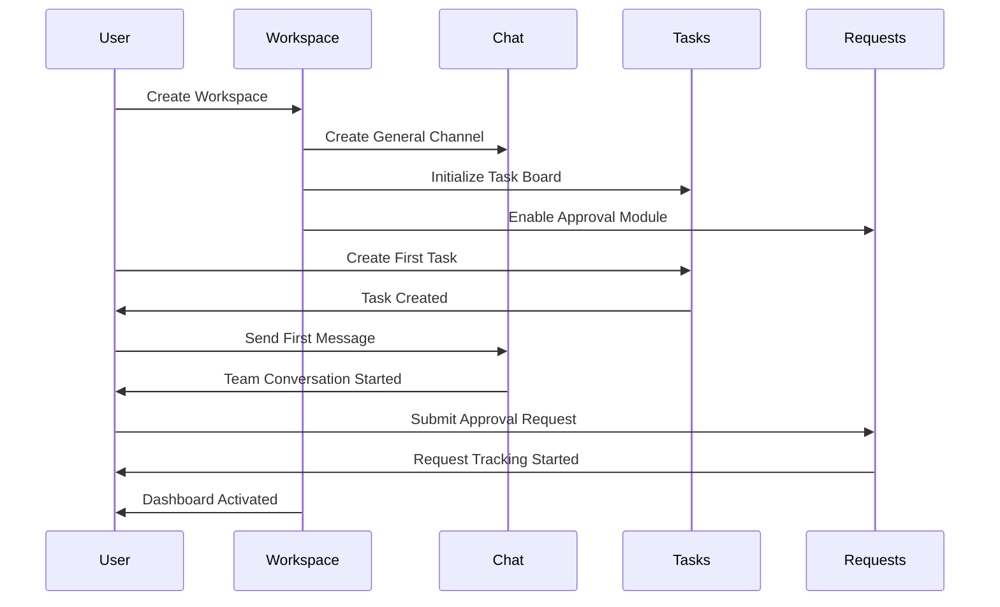
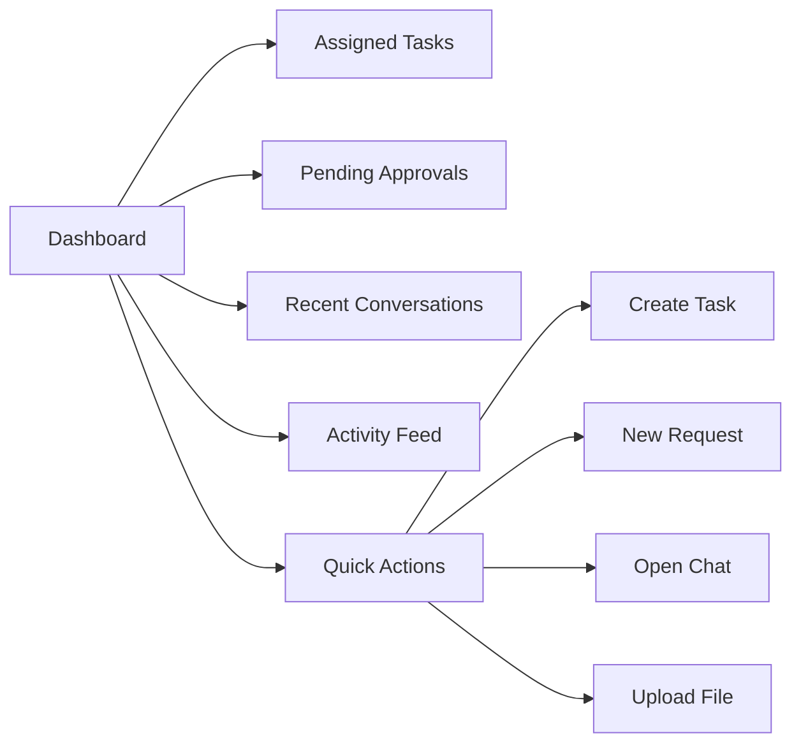
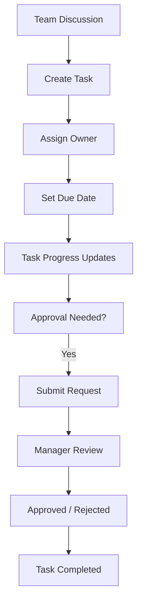

# Team Operations Platform — MVP Onboarding & UX Flow

This document defines the MVP onboarding architecture, navigation structure, dashboard layout, and operational flow for the Team Operations Platform.

---

# 1. MVP Onboarding Flow

---

# 2. Core Product Navigation

---

# 3. First-Time User Activation Flow

---

# 4. Dashboard Layout Structure

---

# 5. Chat + Task Operational Flow

---

This MVP architecture prioritizes:
- operational simplicity,
- low onboarding friction,
- fast team activation,
- and scalable workflow coordination.
